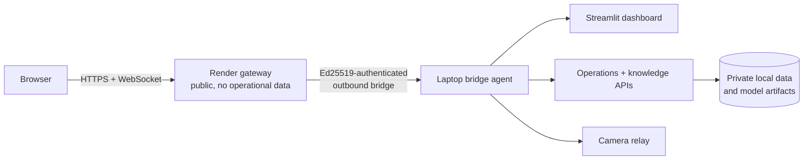

# ForgeCare Live Gateway

An authenticated, fail-closed reverse proxy for a laptop-hosted AI inspection demo. It keeps ForgeCare's operational database, photos, credentials, and model artifacts on the laptop while providing one stable public address.

**[Open the live demo](https://forgecare-ai-live.onrender.com)** · **[Take the always-available tour](https://forgecare-ai-live.onrender.com/about)** · **[Check gateway status](https://forgecare-ai-live.onrender.com/gateway-health)** · **[Read the application source](application/README.md)**

If the laptop is offline, the public URL returns an informative `503` page with a source link instead of forwarding to an expired origin. The `/about` tour remains available in either state, so visitors can inspect the architecture, live bridge status, and evidence boundaries even when the Streamlit UI is waking up. Render's free service may take a moment to wake up.

## 60-second tour

| Start here | What it shows |
| --- | --- |
| [`server.js`](server.js) | Ed25519 bridge authentication, bounded HTTP/WebSocket forwarding, and fail-closed behavior |
| [`test/server.test.js`](test/server.test.js) | Dependency-clean regressions for health responses and offline requests |
| [`application/forgecare/`](application/forgecare/) | The Python inspection workflow, cited knowledge assistant, queue, and federated-learning exercises |
| [`application/docs/RESEARCH_AND_DATA.md`](application/docs/RESEARCH_AND_DATA.md) | Dataset provenance, measured experiments, limitations, and reproduction boundaries |
| [`DEVELOPMENT.md`](DEVELOPMENT.md) | Local setup, repository map, tests, and safe contribution workflow |

The [always-available project tour](https://forgecare-ai-live.onrender.com/about) is served directly by the gateway. It does not require the laptop bridge, operational data, or a Streamlit session.

The Render gateway receives one outbound, authenticated WebSocket connection from the prepared laptop. Browser HTTP and Streamlit WebSocket traffic go through that connection to the laptop's loopback dashboard; `/camera-relay/*` reaches the laptop's camera relay. There is no rotating `trycloudflare.com` hostname.

## Application source

The Python application served through this gateway is included in [`application/`](application/README.md). Its dashboard, operations and knowledge APIs, tests, documentation, and research scripts are visible here. In particular, [`application/forgecare/federation.py`](application/forgecare/federation.py) implements local client training and weighted aggregation; [`application/forgecare/phone_federation_schedule.py`](application/forgecare/phone_federation_schedule.py) runs the reviewed-phone attempt; and [`application/scripts/train_autovi_federated.py`](application/scripts/train_autovi_federated.py) contains the actual Flower automotive research run. This is a source snapshot from the private application repository at commit `fddf126`.

For the file map, PyCharm setup, tests, and contribution workflow, see the [local development guide](DEVELOPMENT.md).

The public gateway has dependency-clean smoke coverage for its fail-closed behavior: CI verifies on Node 20 and 22 that the health endpoint reports an offline laptop without host data and that ordinary requests return `503` until an authenticated bridge connects. The Python application tests remain local because their pinned Python 3.14 environment includes large vision and ML dependencies.

Render still starts the Node gateway in `server.js`; it does not run the Python app or store its operational data. The public source snapshot excludes the laptop's credentials, inspection database and photos, downloaded datasets, and two trained phone research weights. The source datasets have redistribution restrictions, so a fresh checkout cannot reproduce every model demonstration without separately authorized data and weights. The complete working demonstration remains on the connected laptop.

The gateway verifies an Ed25519 signature before accepting the laptop connection. `bridge-public.pem` is public and deployed with this repository; the private signing key stays outside the repository in the prepared laptop's ForgeCare data folder. The gateway stores no inspection records, photos, passwords, or API keys. All four ForgeCare services and their data remain on the laptop.

On the prepared laptop, `ensure-bridge.ps1` checks the local services and starts `bridge_agent.py` if it is not running. `install-gateway-task.ps1` runs that check every minute. The agent reconnects automatically after a transient network or Render restart and sends a heartbeat every 20 seconds. `/gateway-health` reports whether the authenticated laptop bridge is connected. When it is not, the fixed address returns a clear 503 rather than forwarding to an expired origin.

The laptop must remain powered, awake, and online. Render's free service may restart and cannot guarantee uninterrupted availability; the bridge reconnects without changing the URL. For a presentation, keep the laptop plugged in and retain the local `http://127.0.0.1:8501` as a backup. This bridge does not transfer the database or models to Render.

For the 13 November presentation window, the prepared laptop's AC sleep and hibernation timers are disabled, and closing its lid while plugged in no longer puts it to sleep. The previous AC lid-close sleep setting is scheduled to return at 00:05 IST on 14 November using `restore-lid-sleep.ps1`.
